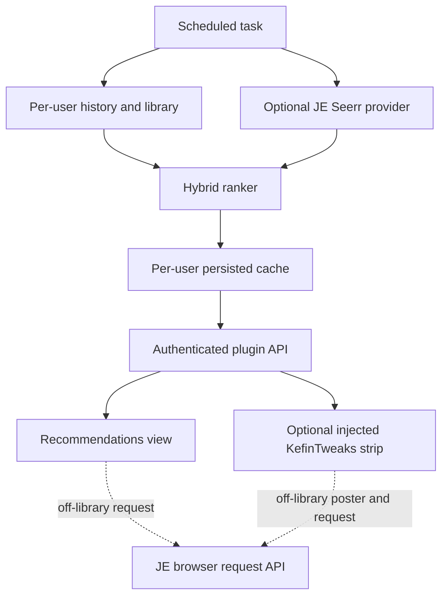

# Requirements

### Overview & Goals
Build a Jellyfin plugin that periodically computes personalized movie and series recommendations per Jellyfin user, caches the results server-side, and serves them to an embedded Jellyfin view through an authenticated plugin API. Anime represented in Jellyfin as series is included.

### Functional Requirements
- Recalculate each user's recommendations in a Jellyfin scheduled task; let administrators configure its trigger cadence through Jellyfin's Scheduled Tasks controls and allow manual runs.
- Use a hybrid ranking that combines similarity to watched titles with available completion, recency, and rating signals; ratings are optional.
- Exclude titles already watched by that user and deduplicate candidates.
- Without an available JE Seerr integration, rank only unwatched items in that user's Jellyfin library.
- When JE is installed, Seerr is configured, and the relevant integration is usable, include off-library Seerr candidates in the scheduled result cache and offer JE's request action in the view.
- If JE is absent, unavailable, unconfigured, or a user is not linked, retain library-only results and keep the view usable.
- Scope history, cached results, and API responses to the authenticated Jellyfin user; never accept an arbitrary user ID from the frontend as authorization.
- Expose a Jellyfin item-list API compatible with KefinTweaks custom home-screen sections, returning only the authenticated user's visible in-library recommendations in standard Jellyfin DTO format.
- Offer an optional KefinTweaks home-screen integration that renders the full cached recommendation list, including off-library Seerr cards with JE poster and request actions when JE is available.

### Scope
**In scope:** Jellyfin scheduled refresh, per-user hybrid ranking, server-side cached results, an authenticated API and embedded view, optional JE/Seerr candidate and request integration, and an opt-in KefinTweaks JavaScript Injector integration.

**Out of scope:** a separately configured Seerr connector or credentials, collaborative ranking across users, and any edits to `External` (reference-only/read-only).

# Technical Design

### Current Implementation
The root contains `Jellyfin-FYP.sln` but no plugin implementation. The read-only references establish relevant patterns:
- `External/Jellyfin-Enhanced-main/Jellyfin.Plugin.JellyfinEnhanced/ScheduledTasks/BuildTagCacheTask.cs` implements `IScheduledTask` and `IConfigurableScheduledTask`, returns default triggers, and reports task progress.
- `External/Jellyfin-Enhanced-main/Jellyfin.Plugin.JellyfinEnhanced/Services/TagCacheService.cs` uses a concurrent in-memory cache persisted as JSON, a useful pattern for server-side computed results.
- `External/Jellyfin-Enhanced-main/Jellyfin.Plugin.JellyfinEnhanced/Controllers/JellyfinEnhancedController.cs` demonstrates authenticated plugin routes. Its Seerr movie/TV recommendation proxy actions are `[Authorize]` endpoints, including `jellyseerr/movie/{tmdbId}/recommendations` and `jellyseerr/tv/{tmdbId}/recommendations`.
- `External/Jellyfin-Enhanced-main/Jellyfin.Plugin.JellyfinEnhanced/JellyfinEnhanced.cs` registers embedded views; `PluginPages/RecommendationsPage.html` shows the page pattern.
- `External/Jellyfin-Enhanced-main/Jellyfin.Plugin.JellyfinEnhanced/js/jellyseerr/api.js` exposes the UI request action `JE.jellyseerrAPI.requestMedia`.
- `External/KefinTweaks-main/helpers/dataHelper.js` demonstrates retrieving watched Jellyfin items with `IsPlayed` and user/media metadata.

### Key Decisions
- Move history retrieval, candidate generation, scoring, and refresh orchestration to plugin server services. An `IScheduledTask` implementation processes users independently and uses Jellyfin's scheduled-task trigger settings so administrators can configure cadence and run it manually.
- Compute a hybrid score from watched-title metadata similarity and available user signals (completion, recency, ratings); use unwatched local movies and series as the baseline candidate set.
- Store computed results per Jellyfin user in a plugin-owned cache, persisted under Jellyfin's plugin data path and held in memory for API reads. Replace a user's cache only after a successful refresh so a partial failure does not erase the last usable results.
- Add an authenticated recommendations API that derives the user ID from the Jellyfin request identity, returns only that user's cached results, and exposes refresh metadata. The browser only fetches and renders the response; it does not rank or load watch history.
- For optional off-library candidates, isolate the scheduled-task Seerr proxy behind a server-side provider that is enabled only when JE is installed and uses JE's existing Seerr configuration and per-user linkage; keep JE's browser API for poster rendering and request submission. Do not add a separate Seerr configuration or credentials. If JE is unavailable, unconfigured, or cannot be accessed safely, retain local-only cached recommendations.
- Ship a separate opt-in KefinTweaks integration script loaded through Jellyfin's JavaScript Injector. It consumes the authenticated mixed recommendation API and renders a dedicated home-screen strip; leave KefinTweaks' custom endpoint contract library-only and use JE's browser details/request APIs for off-library cards.

### Proposed Flow

### File Structure
Add a plugin project and register it in `Jellyfin-FYP.sln`:
- `Jellyfin.Plugin.WatchRecommendations/Jellyfin.Plugin.WatchRecommendations.csproj` and `Plugin.cs` — plugin bootstrap, embedded view, and task/service registration.
- `Jellyfin.Plugin.WatchRecommendations/ScheduledTasks/RebuildRecommendationsTask.cs` — configurable Jellyfin scheduled task that refreshes users' cached results.
- `Jellyfin.Plugin.WatchRecommendations/Services/` — user history/library retrieval, hybrid ranking, per-user persisted cache, and optional JE Seerr candidate provider.
- `Jellyfin.Plugin.WatchRecommendations/Controllers/RecommendationsController.cs` — authenticated endpoint for the current user's cached recommendations.
- `Jellyfin.Plugin.WatchRecommendations/PluginPages/RecommendationsPage.html` and `js/` — fetch/render cached results and use JE's request API when available.
- `Jellyfin.Plugin.WatchRecommendations/Integrations/KefinTweaksRecommendations.js` — optional JavaScript Injector integration that adds a dedicated mixed-recommendations strip to KefinTweaks' home screen.
- `README.md` — setup instructions for the optional injector script and the library-only custom endpoint.
- Add focused scheduled-task, ranking, cache, API authorization, and JE integration tests in a test project.

### Risks
JE's Seerr proxy actions are authenticated controller routes, not a documented cross-plugin background-task contract. Implement an isolated scheduled-task proxy using JE's existing configuration and linked-user mapping only when JE is installed; do not expose credentials, add separate Seerr settings, or modify `External`. Verify the user-scoping and authorization behavior, bound Seerr requests, fail closed to library-only results when JE is absent/unconfigured/unlinked, and preserve the last successful cache when refreshes fail.

# Testing

### Validation Approach
- Build the plugin and solution; verify the scheduled task, controller endpoint, and embedded view are registered and packaged.
- Use deterministic fixtures to test hybrid scoring, optional ratings, mixed movies/series, duplicate provider IDs, and watched-item exclusion.
- Exercise per-user refresh/cache behavior, persisted cache reload, cancellation/failure handling, and endpoint authorization with multiple Jellyfin users.
- Mock the JE provider states: plugin absent, Seerr disabled/unlinked, server-side call succeeds, and call fails; verify request handoff remains optional in the UI.
- Validate the optional KefinTweaks script's user scoping, mixed item ordering, duplicate-row prevention, graceful JE fallback, and JE poster/request calls.

### Key Scenarios
- An administrator can configure the task trigger in Jellyfin and run a refresh manually; refresh computes results separately for each eligible user.
- The authenticated API returns the caller's cached recommendations and never returns another user's data, even if a different user ID is supplied as a query parameter.
- A successful JE integration adds and deduplicates off-library recommendations in the cache; JE request actions remain available from the UI.
- With JE absent, unconfigured, unlinked, or failing, refreshed results remain library-only and the recommendations page still works.
- A failed per-user refresh preserves the previous cache; a server restart reloads persisted cached results.
- With the injector script enabled, KefinTweaks displays the cached mixed recommendations in rank order; external cards load posters and submit requests through JE, while missing JE leaves local cards usable.

# Delivery Steps

### ✓ Step 1: Bootstrap the plugin, scheduled task, and API/view boundaries
A buildable Jellyfin plugin registers its recommendations view, configurable refresh task, and authenticated API controller.

- Add the plugin project and register it in `Jellyfin-FYP.sln`, following the `BasePlugin`/`IHasWebPages` and `GetViews()` pattern.
- Add `RebuildRecommendationsTask` with `IScheduledTask` and `IConfigurableScheduledTask`, providing a default trigger editable through Jellyfin's Scheduled Tasks UI.
- Add the controller and embedded page skeleton, establishing that requests resolve the current Jellyfin user from authentication.
- Verify plugin build and registration of the task, API route, and embedded view.

### ✓ Step 2: Implement per-user ranking and persisted recommendation cache
The scheduled task computes deterministic hybrid recommendations per Jellyfin user and stores each user's last successful result for fast API reads.

- Add server-side history/library retrieval and candidate selection for unwatched movies and series.
- Implement hybrid scoring from metadata similarity plus available completion, recency, and rating signals.
- Add a per-user cache persisted under the plugin data path, with atomic per-user replacement and refresh timestamps.
- Add ranking, cache reload, multi-user isolation, cancellation, and partial-refresh failure tests.

### ✓ Step 3: Add optional JE Seerr candidate retrieval to scheduled refresh
When JE is installed and its Seerr integration and user linkage are usable, a scheduled-task proxy reuses that configuration to retrieve off-library candidates; otherwise refresh remains library-only.

- Implement an isolated Seerr proxy/provider that detects JE and reuses its configured Seerr endpoint, credentials, and linked-user identity without adding separate settings or relying on an authenticated browser request.
- Merge and deduplicate external candidates with Jellyfin candidates, exclude items already watched, and retain prior cached results if an optional provider fails.
- Keep poster rendering and request submission in the browser through JE's existing API; add mocked tests for JE availability, configuration/link failure, duplicates, and fallback.

### ✓ Step 4: Serve cached results through the current-user API and render them
The recommendations page displays the signed-in user's cached server-ranked results, loads off-library Seerr posters through JE when available, and can request those items through JE.

- Implement the authenticated GET endpoint to derive the user from the request and return only that user's cached recommendations and refresh metadata.
- Update the embedded page to fetch, render, and handle empty, loading, stale, and library-only results without client-side ranking.
- Resolve off-library poster art through JE's movie/TV details API, and connect request buttons to JE's request API with a graceful fallback when it is not present.
- Add endpoint authorization and UI integration tests, including attempts to retrieve another user's cached data.

### ✓ Step 5: Expose recommendations to KefinTweaks custom home-screen rows
KefinTweaks can use a plugin endpoint as a custom query and render the signed-in user's recommended library items as Jellyfin cards.

- Add a separate authenticated custom-endpoint route that returns `{ Items, TotalRecordCount }` using Jellyfin item DTOs; preserve the existing metadata API response.
- Resolve cached recommendations against current Jellyfin items, include only visible in-library movies and series, preserve ranking order, and honor a bounded `Limit` while deriving the user only from authentication.
- Document the endpoint path and KefinTweaks custom-query configuration; test DTO-list response shape, item eligibility/order/limit, and user isolation.

### ✓ Step 6: Add an optional mixed-recommendations strip to KefinTweaks
An opt-in JavaScript Injector integration adds a dedicated KefinTweaks home-screen strip with the signed-in user's cached library and off-library recommendations, using JE for external posters and requests when available.

- Add a standalone integration script that loads the authenticated cached recommendations, resolves in-library items to Jellyfin DTOs, preserves ranking order, and renders a dedicated home-screen strip without modifying KefinTweaks.
- Use JE's browser API for Seerr user eligibility, external poster details, and request submission; keep local cards available if JE is absent/unlinked or calls fail.
- Handle Jellyfin user changes, SPA home-screen navigation, stale async responses, duplicate initialization, and missing plugin APIs safely.
- Document how to load the script using JavaScript Injector and how to avoid duplicate local rows; add focused validation for mixed ordering and optional JE behavior.